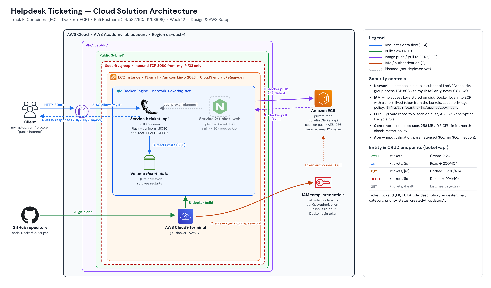

# Helpdesk Ticketing on AWS (EC2 + Docker + ECR)

Individual project for **Cloud Computing (Komputasi Awan)**, Week 12: Design & AWS Setup.
Author: **Rafi Busthami** (24/532760/TK/58998), S1 Teknologi Informasi, DTETI UGM.

A small helpdesk ticketing backend. Users report IT problems as tickets (e.g. "Wi-Fi drops in the lab"), and staff read them, update their status, and close them.

| | |
|---|---|
| **Track** | B: Containers (EC2 + Docker + ECR) |
| **Services (planned)** | 1. `ticket-api`: REST API, Flask + gunicorn, **built this week**<br>2. `ticket-web`: nginx web UI + reverse proxy, **planned** |
| **Docker image** | `ticket-api`, pushed to the private Amazon ECR repository `ticketing/ticket-api` |
| **Compute** | Amazon EC2 t3.small (Amazon Linux 2023), created as the AWS Cloud9 environment `ticketing-dev` |
| **Data** | SQLite file on the Docker volume `ticket-data` |
| **Environment** | AWS Academy lab account (Lab Project, $40 budget), region `us-east-1` |

## Architecture



**Request flow:** **1** the client sends HTTP to the EC2 public IP on port 8080 → **2** the security group only lets in my IP → Docker forwards port 8080 to the `ticket-api` container → **3** the API reads and writes SQLite on the `ticket-data` volume → **4** JSON response.

**Build & deploy flow:** **A** `git clone` into Cloud9 → **B** `docker build` → **C** `aws ecr get-login-password` (short-lived IAM token) → **D** `docker push` to ECR → **E** `docker pull` from ECR and `docker run`.

Diagram source: [`docs/architecture.html`](docs/architecture.html), generated by [`docs/diagram/build_diagram.py`](docs/diagram/build_diagram.py).

## Data entity: `Ticket`

| Attribute | Type | Rules |
|---|---|---|
| `ticketId` | TEXT (UUID v4) | Primary key, generated by the API |
| `title` | TEXT | Required, 3–120 chars |
| `description` | TEXT | Optional, max 2000 chars |
| `requesterEmail` | TEXT | Required, valid email, stored lowercase |
| `category` | Enum | `HARDWARE`, `SOFTWARE`, `NETWORK`, `ACCOUNT`, `OTHER` |
| `priority` | Enum | `LOW`, `MEDIUM` (default), `HIGH`, `URGENT` |
| `status` | Enum | `OPEN` (default), `IN_PROGRESS`, `RESOLVED`, `CLOSED` (indexed) |
| `createdAt`, `updatedAt` | TEXT (ISO 8601, UTC) | Set by the API |

## CRUD endpoints (`ticket-api`, port 8080)

| # | Method | Path | Action | Success | Errors |
|---|---|---|---|---|---|
| 1 | `POST` | `/tickets` | **Create** a ticket | `201` + ticket | `400` validation |
| 2 | `GET` | `/tickets/{ticketId}` | **Read** one ticket | `200` + ticket | `400` bad id, `404` |
| 3 | `PUT` | `/tickets/{ticketId}` | **Update** title / description / category / priority / status | `200` + ticket | `400`, `404` |
| 4 | `DELETE` | `/tickets/{ticketId}` | **Delete** a ticket | `204` | `400`, `404` |
| + | `GET` | `/tickets?status=OPEN&limit=20` | List (extra) | `200` + `{count, items}` | `400` |
| + | `GET` | `/health` | Health / connectivity check | `200` | |

```bash
curl -X POST http://<EC2_PUBLIC_IP>:8080/tickets -H 'Content-Type: application/json' \
  -d '{"title":"Projector not working","requesterEmail":"me@mail.ugm.ac.id","category":"hardware","priority":"high"}'
```

## Repository layout

```
├── app/
│   ├── app.py               ticket-api (Flask): routes, validation, SQLite
│   ├── Dockerfile           python:3.12-slim (from ECR Public), non-root, HEALTHCHECK
│   └── requirements.txt
├── web/                     ticket-web (planned service 2): nginx.conf + index.html
├── docker-compose.yml       both services (ticket-web behind the "planned" profile)
├── infra/
│   ├── ecr-lifecycle-policy.json
│   ├── iam-least-privilege-policy.json
│   └── security-group-rules.md
├── scripts/
│   ├── build_push.sh        create ECR repo, build, tag, push
│   ├── run_from_ecr.sh      pull from ECR and run with a volume
│   ├── smoke_test.sh        AWS/EC2/ECR/container/CRUD checks -> docs/evidence/
│   └── teardown.sh          remove container and ECR repo
├── tests/test_api.py        14 unit tests (pytest)
└── docs/                    architecture, design brief, deployment plan, evidence
```

## Deploy (AWS Cloud9 terminal on the EC2 instance)

```bash
git clone https://github.com/RafiBusthami/ticketing-docker-aws.git
cd ticketing-docker-aws
bash scripts/build_push.sh     # ECR repo + docker build + push
bash scripts/run_from_ecr.sh   # pull from ECR + run on :8080
bash scripts/smoke_test.sh     # evidence -> docs/evidence/smoke-test-output.txt
```

Full steps, costs and checks: [`docs/deployment-plan.md`](docs/deployment-plan.md).

## Run locally

```bash
pip install -r requirements-dev.txt && pytest -v
docker compose up -d --build && curl localhost:8080/health
```

GitHub Actions runs the unit tests, builds the image and checks `/health` on every push ([`.github/workflows/ci.yml`](.github/workflows/ci.yml)).

## Security summary

- Security group: port 8080 open to **my IP /32 only**.
- No AWS access keys stored anywhere; ECR login uses a 12-hour token from the lab's IAM role.
- Private ECR repository with scan on push, AES-256 encryption and a lifecycle rule.
- Container runs as a non-root user with CPU/memory limits, a health check and a restart policy.
- Input validation and parameterised SQL in the API.
